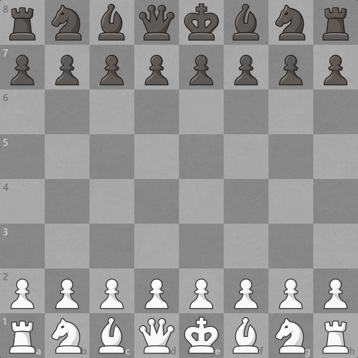

# Lichess Grey Board for Chess.com

The original textured grey Lichess board on Chess.com. Keeps your existing pieces,
move highlights, controls, board size, and animations.

## Firefox Developer Edition: for people who like to tinker

If you're the hacky, tweak-everything type, [Firefox Developer Edition](https://www.mozilla.org/firefox/developer/)
is a much better fit for this kind of customization. It is built for developers
and lets you keep unsigned local extensions installed across restarts.

1. In **Firefox Developer Edition**, open `about:config`.
2. Set `xpinstall.signatures.required` to `false`.
3. Download `lichess-grey-board-firefox.xpi` from [Releases](https://github.com/lautpuspa/chesscom-lichess-grey-board/releases/latest).
4. Open `about:addons` → gear menu → **Install Add-on From File…**, and select the XPI.
5. Refresh Chess.com. The skin stays installed when you restart the browser.

This disables extension signature checks for that browser profile, so install
only add-ons you trust. Standard Firefox does not support this setting.
See [Mozilla's signing guide](https://support.mozilla.org/en-US/kb/add-on-signing-in-firefox).

Or just tell your agents to install this shi lol.

## Standard Firefox: install permanently with Stylus

1. Install [Stylus for Firefox](https://addons.mozilla.org/firefox/addon/styl-us/).
2. Open [the UserCSS style](https://raw.githubusercontent.com/lautpuspa/chesscom-lichess-grey-board/main/lichess-grey-board.user.css).
3. Click **Install style** in Stylus. If the browser displays the file as text,
   use Stylus → Manage → Write new style, paste the complete file, accept UserCSS
   conversion if prompted, and save.
4. Refresh Chess.com.

The style applies only to `chess.com`. Use one installation method at a time.

## Temporary extension installation

Download the Firefox `.xpi` or `.zip` from [Releases](https://github.com/lautpuspa/chesscom-lichess-grey-board/releases/latest).
Open `about:debugging#/runtime/this-firefox`, click **Load Temporary Add-on**,
and select the archive or this repository's `manifest.json`. Refresh Chess.com.

Requires Firefox 142 or newer. Firefox removes temporary add-ons on exit.
For persistent installation, use Developer Edition or the Stylus method above.

## What runs

Only CSS. No JavaScript, background process, storage access, engine, analysis,
network interception, or analytics. The original JPEG is embedded locally, so
there are no image requests. Site access is restricted to Chess.com.

Verified in an isolated Firefox 158 profile: installation, reload, original piece
images and board dimensions, native e2–e4 on the analysis board, narrow viewport,
and uninstall restoring the original background. `web-ext lint` reports no
errors, notices, or warnings. Live rated games and every Chess.com board mode
were not exercised. Site markup changes may require a CSS update.

## Source and license

AGPL-3.0-or-later. Texture copyright the lila authors and pirouetti.
The original [`grey.jpg`](https://github.com/lichess-org/lila/blob/7ee0938942be063ca0b70084e70108bd1bea661a/public/images/board/grey.jpg)
bytes are embedded unchanged in `board.css` and the UserCSS style. See
[LICENSE](LICENSE) and [Lichess's attribution record](LICHESS-COPYING.md).

Unofficial customization; not affiliated with Chess.com or Lichess.
